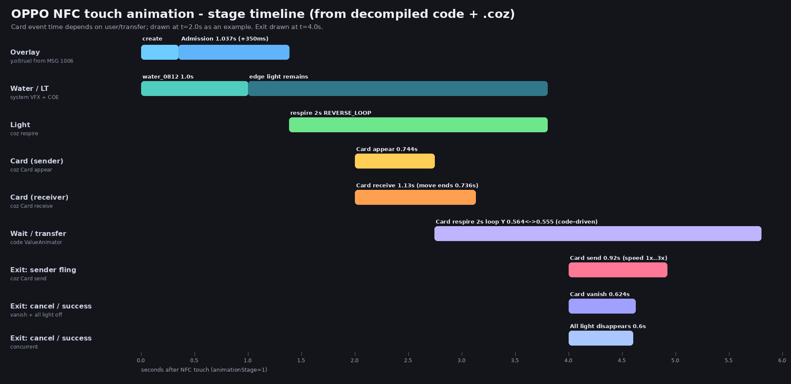
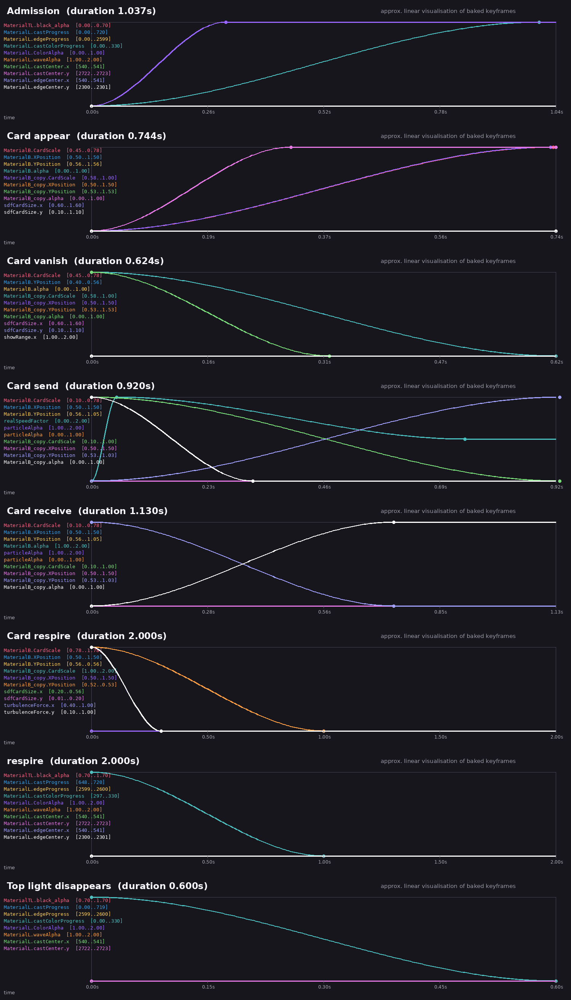
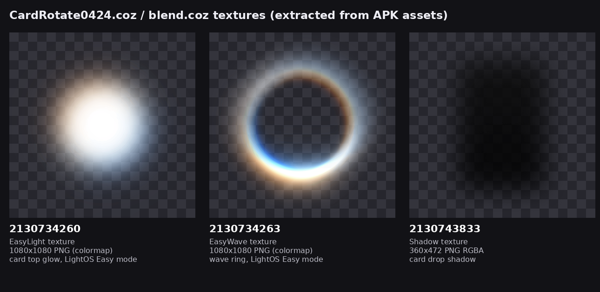

# OPPO「碰一碰」连接动画逆向研究

> 研究对象：`Temp/AccessoryFramework.apk`（`com.heytap.accessory` / OPPO Quick Connect，versionName **16.35.0**，versionCode 160350000）。
> 反编译树：`_Temp/afk/jadx_out/`；smali：`_Temp/afk/smali_classes*/`。
> 动画素材：`_Temp/oppo_anim/`（`.coz`、纹理、OGG、`.he`、UPK 均已在其中）。
> 本文所有结论来自反编译代码 + `.coz` 数据；不确定处标 `[未确定]`。**预览图/GIF 是近似示意，不是 OPPO 原始渲染。**

---

## 0. 结论速览（先看这 6 条）

1. **OPPO 碰一碰的全屏动效 = 两套引擎叠加**：
   - **卡片/光效/粒子**：APK 内置 COE 引擎（`libnaiveEngine.so`）播放 `CardRotate0424.coz`；
   - **水波纹**：`com.coe.syseffect.e` 播放 `water_0812.coz`，通过反射调用系统隐藏 API `SurfaceControl.Transaction#setVfxAnimation`，由**系统合成器**渲染到 SurfaceControl 上。两者不是同一套渲染。
2. **动画阶段固定为**：触碰 → 水波（1.0s）+ `Admission` 光效（1.037s，触碰后 350ms 开始）→ `respire` 光效呼吸循环 → 卡片入场（发送方 `Card appear` 0.744s；接收方 `Card receive` 1.13s，位移 0.736s）→ 等用户/传输（卡片用代码驱动 2s 呼吸）→ 发送方上滑 `Card send` 0.92s 或取消；结束统一走 `Card vanish` 0.624s + `All light disappears` 0.6s，然后释放悬浮窗。
3. **“连接成功”没有单独的动画段**。传输成功（`onResult 1000` / 合约结束）只是结束全屏动画：隐藏进度条，播放**收尾**（Vanish + AllLightDisappears），随后释放 overlay。全屏层里没有 success/checkmark 之类的 animator。真正“成功状态”的常驻 UI 是**状态栏/锁屏的 Pantanal 种子卡**（`PTCConnectSeedling.upk`），不属于这套 COE 动画。
4. 网上/APK 里名字带 `fast_pair_success` 的资源是**蓝牙 Fast Pair 通知**的静态状态图（`assets/modelId_*/config_os12.xml` + `image_connected.png`），**不是碰一碰动画**；`raw/complete_page_success_anim` 是 COUI 通用完成页 Lottie，NFC 包内没有使用。
5. 关键数值：黑幕 `black_alpha 0→0.7`（shader 内 ×1.143 ≈ 实际 0.8）；卡片宽度 `CardScale=0.7777`（=840/1080，卡片纹理 840×1290）；卡片中心 `YPosition=0.564`（GL 坐标从底部算，即屏幕高度 43.6% 处）；光色 `frontColor=#1E90FF`、`backColor=#00BABD`；`respire` 2s 乒乓循环；卡片呼吸 Y `0.564↔0.555`（±0.009 屏高 ≈ ±3.6dp@3x）。
6. 我们现有实现已经非常接近：`PHOTO_BREATHE_MS=2000`、`PHOTO_BREATHE_FRAC=0.0103` 与 OPPO 的 2s / ±0.009 屏高基本一致；主要差距是**入场/收尾时长、卡片宽度、水波源位置（OPPO 在顶边中点，不在屏幕中心）**以及缺少 600ms 的“全光熄灭”收尾。具体对齐建议见 §9.4。

---

## 1. 证据与阅读约定

### 1.1 文件缩写

| 缩写 | 实际路径 |
|---|---|
| `NfcUIService.java` | `_Temp/afk/jadx_out/sources/com/oplus/interconnect/nfc/ui/NfcUIService.java` |
| `i.java` | `.../nfc/ui/animation/i.java`（NfcAnimationManager，混淆名） |
| `y.java` | `.../nfc/ui/animation/y.java`（NfcTouchingAnimationView，混淆名，5019 行） |
| `startAdmission$1.java` | `.../animation/NfcTouchingAnimationView$startAdmissionAnimation$1.java` |
| `startCardEnter$2.java` | `.../animation/NfcTouchingAnimationView$startCardEnterAnimation$2.java` |
| `initMediaPlayer$1.java` | `.../animation/NfcTouchingAnimationView$initMediaPlayer$1.java` |
| `f.java` | `.../nfc/ui/card/f.java`（NfcCardViewManager） |
| `NfcShare d.java` | `.../nfc/share/d.java`（NfcShare） |
| `COEEngine.java` | `.../com/oplus/vfxsdk/naive/COEEngine.java` |
| `syseffect e.java` | `.../com/coe/syseffect/e.java`（COESysEffect） |
| `scene.json` | `_Temp/oppo_anim/CardRotate0424/scene.json` |
| `water scene.json` | `_Temp/oppo_anim/water_0812/scene.json` |
| `aapt2` 资源表 | `aapt2 dump resources Temp/AccessoryFramework.apk` |

行号以当前反编译文件为准；jadx 行号可能因重跑变化，类/方法名与日志文本是稳定锚点。

### 1.2 已确认的事实锚点

- `NfcTouchingAnimationView` 被混淆为 `y`，`NfcAnimationManager` 为 `i`，`NfcCardViewManager` 为 `f`，NfcShare 为 `d`。
- 代码实际加载的场景是 **`CardRotate0424.coz`**（`y.java:4619`），不是 `blend.coz`；`blend.coz` 虽在 APK assets 内，但 NFC 代码没有引用。
- 水波场景是 **`water_0812.coz`**（`WaterAnimationHelper$startWaterAnimation$1.java:94`）。

---

## 2. 动画阶段 ↔ 触发代码 ↔ 资源 ↔ 时长（总表）

| # | 阶段 / 用户看到什么 | 触发时机 | 触发代码（精简） | 资源 / animator | `NfcAnimationType` | 时长 |
|---|---|---|---|---|---|---|
| 0 | 触碰后出现全屏悬浮层（透明、锁定方向、可选背景模糊） | 系统服务收到 `com.oplus.pantaconnect.NFC.animationStart`（`animationStage=1`） | `NfcUIService.java:120-158` → `i.java:32-40`（MSG 1006）→ `y.o(true)`（`y.java:4517`） | 悬浮窗布局 `R.layout.nfc_card_operate_view` + `CardRotate0424.coz` | — | 建层/加载 |
| 1 | 水波纹从两台手机接触的屏幕边缘扩散（折射背景） | 悬浮层创建后（先等 SurfaceView attach，最多 500ms；**仅普通模式**，Easy 模式跳过水波） | `y.java:4913` → `syseffect e.java:366` → 系统 VFX | `water_0812.coz` / `animator1` | —（独立系统 VFX） | **1.0s**（曲线关键帧到 0.8/1.0s） |
| 2 | 屏幕顶部/边缘亮起蓝色光带，黑幕压下 | 普通模式：水波启动后 **350ms**（`O=350L`，`y.java:289`）；Easy 模式：建层后立即 | `y.java:4923`（普通）/ `y.java:4904`（Easy）→ `p.java:104` → `y.n()`（`y.java:4506`）→ `startAdmission$1.java:60` | `CardRotate0424.coz` / **`Admission`** | `Admission` / `Land_Admission` / `EasyAdmission` | **1.037s** |
| 3 | 光带开始缓慢呼吸（常驻，等用户操作） | `Admission` 结束回调 | `startAdmission$1.java:96-110` | 同场景 / **`respire`**（`REVERSE_LOOP`） | `Respire` / `Land_respire` / `EasyRespire` | **2.0s 单程**，乒乓循环（一个往返 4s） |
| 4 | 发送方：卡片从中心放大出现 | `showNfcCard(isSender=true)` | `f.java:257/352` → `y.p()`（`y.java:4930`）→ `y.d()`（`y.java:3019`） | 同场景 / **`Card appear`** | `Appear` / `Land_Card appear` | **0.744s** |
| 5 | 接收方：卡片从屏幕上方落下 | `showNfcCard(isSender=false)` | `f.java:257/352` → `y.c()`（`y.java:1253`） | 同场景 / **`Card receive`** | `CardReceive` / `Land_Card receive` | **1.13s**（位移 0.736s，粒子尾迹到 1.13s） |
| 6 | 卡片待机呼吸（用户可拖动） | 卡片入场动画结束 | `y.java:1429-1437` / `y.java:4799-4826` | **不是** coz 的 `Card respire`，是代码 `ValueAnimator` | `CardRespire`（仅枚举语义） | **2.0s 循环** |
| 7 | 发送方上滑：“卡片向上飞走 + 粒子喷射” | 发送方上滑手势 | `t.java:49-50` → `y.i(false, CardSend, speed)` → `y.java:4413` → `CardSendAnimationRunner`（`d.java:42`） | 同场景 / **`Card send`** | `CardSend` / `Land_Card send` | **0.92s**，速度 1×–3× |
| 8 | 发送方超时（60s）/ 下滑取消 | 超时 / 下滑 | `t.java:22-37,84-95` → `y.h()`；`card_cancel.ogg` | `Card vanish`+`All light disappears`（取消全部）或 `Card send`（进度中） | `Vanish` / `AllLightDisappears` | 0.624s / 0.6s |
| 9 | 接收方点“接收”→ 圆形进度条 | 按钮点击 | `y.java:1000-1060` → `showProgressBar`（`NfcTouchingAnimationView$showProgressBar$1.java`） | 代码弹簧动画（`x8.c`，非 COE） | — | 弹簧收敛 |
| 10 | 传输成功/结束：进度消失、光效熄灭、overlay 释放 | `onResult 1000`（成功）/ 合约结束 | `NfcShare d.java:935` → `f.java:129-155`（`j()` → `y.h()`）→ `allAnimationCancel$1` → `y.a()` | **`Card vanish` + `All light disappears`**（并发） | `Vanish` + `AllLightDisappears` | **0.624s + 0.6s** |
| 11 | 失败：状态栏/锁屏“种子卡”显示失败 | `connectError`（由业务层/`processor/d.java:160` 发起）；`onResult 1001` 只把传输结果置失败 | `NfcUIService.java:226-232` → `seedling/c.java`（类型 12/19/20 的失败文案在 `seedling/c.java:544-612,731-750`） | `PTCConnectSeedling.upk`（Pantanal 卡片） | — | 卡片计时器 3.5s/5s/60s 等 |
| 12 | “连接成功”常驻状态 | 传输成功/连接建立后 | `seedling/c.java:165-171` 发 `OAF_NFC_ANIMATION_END`，更新种子卡 | `PTCConnectSeedling.upk` | — | 常驻/定时 |

> 表中 350ms 和 650ms 是代码常量：`O=350L`、`P=650L`（`y.java:289-290`）。卡片入场若距 `Admission` 开始不足 650ms，代码会补延时到 650ms（`y.java:1360-1374`、`y.java:3095-3105`），避免卡片和光效起势撞在一起。

### 2.1 `NfcAnimationType` 枚举 ↔ 实际 animator 字符串

`NfcAnimationType.java:31-56` 共 26 个值，枚举的 `value` 就是 `.coz` 里的 animator 名（`a()` 返回该字符串）。触发关系如下：

| 枚举 | animator 字符串 | 什么时候用 |
|---|---|---|
| `Admission` / `LandAdmission` / `EasyAdmission` / `LandEasyAdmission` | `Admission` / `Land_Admission` / `EasyAdmission` / `LandEasyAdmission` | 触碰后 350ms 的光效入场 |
| `Respire` / `LandRespire` / `EasyRespire` / `LandEasyRespire` | `respire` / `Land_respire` / `EasyRespire` / `LandEasyRespire` | Admission 结束后的光效呼吸（`REVERSE_LOOP`） |
| `Appear` / `LandAppear` | `Card appear` / `Land_Card appear` | **发送方**卡片入场 |
| `CardReceive` / `LandCardReceive` | `Card receive` / `Land_Card receive` | **接收方**卡片入场 |
| `CardSend` / `LandCardSend` | `Card send` / `Land_Card send` | 发送方上滑/自动发送/进度中取消 |
| `Vanish` / `LandVanish` | `Card vanish` / `Land_Card vanish` | 取消全部/收尾时的卡片退场 |
| `TopLightDisappears` / `LandTopLightDisappears` | `Top light disappears` / `Land_Top light disappears` | 只关顶部光（本流程未直接使用） |
| `EdgeLightDisappears` / `LandEdgeLightDisappears` | `Edge light disappears` / `Land_Edge light disappears` | 只关边缘光（本流程未直接使用） |
| `AllLightDisappears` / `LandAllLightDisappears` | `All light disappears` / `Land_All light disappears` | 取消/成功收尾时关全部光 |
| `CardRespire` / `LandCardRespire` | `Card respire` / `Land_Card respire` | 仅被设为 `REVERSE_LOOP`，代码未 `playAnim`；实际呼吸由 ValueAnimator 驱动 |
| `EasyDisappears` / `LandEasyDisappears` | `EasyDisappears` / `LandEasyDisappears` | Easy 模式的收尾（替代 AllLightDisappears） |

> `Land_*` 由 `y.t(true)` 映射（`y.java:4987-5018`）；`Easy*` 由 `f6263e0` 选择（`y.java:324-365`）。

---

## 3. 触发链路详解

### 3.1 系统 → 服务：`animationStart`

`NfcUIService.onStartCommand()` 处理 7 个 action（`NfcUIService.java:62-240`）：`connectConfirm`、`seedingCard`、`animationStart`、`cancelSeeding`、`animationCancel`、`stopService`、`connectError`。其中与全屏动画直接相关的是 **`animationStart` / `animationCancel`**。

- `com.oplus.pantaconnect.NFC.animationStart`（`NfcUIService.java:120`）：从 `extra_device_bundle` 取
  - `animationStage`（默认 0，只有 `1` 被处理）
  - `animationRole`（0 = `InternalNfcEventRole.SENDER`，1 = `RECEIVER`；UI 日志里叫 `isShotScreen`）
  - `animationEventType`（默认 1）
  - `animationBusinessAction`（默认 1）
  然后 `i.java` 的 Handler 发 `MSG_TOUCHING_ANIMATION = 1006`（`NfcUIService.java:142`），并把 `isShotScreen = (role == 0)` 放在 `msg.obj`。
- `com.oplus.pantaconnect.NFC.animationCancel`（`NfcUIService.java:171-176`）：发 `MSG_CANCEL_TOUCHING_ANIMATION = 1007`。
- `com.oplus.pantaconnect.NFC.seedingCard` / `connectConfirm` / `connectError` / `stopService`：种子卡与错误 UI，不走全屏 COE。

`i.java`（NfcAnimationManager，单例，持有一个 `y` 实例）：

```java
// i.java:32-40
if (i10 == 1006) {                  // MSG_TOUCHING_ANIMATION
    handler.removeMessages(1006);
    this.f6214b.o(true);            // NfcTouchingAnimationView.o(true)
} else if (i10 == 1007) {           // MSG_CANCEL_TOUCHING_ANIMATION
    handler.removeCallbacksAndMessages(null);
}
```

注意：`y` 是**单例常驻**的（`i.java:19` `new y()`），每次触碰复用同一个实例；`o(true)` 内部用生命周期状态机（`o9.b` + `NfcAnimatorState`）防止重入。

### 3.2 建层 + 初始化引擎：`y.o(true)`

`y.o(boolean z10)`（`y.java:4517-4929`）关键步骤：

1. 生命周期 `Stopped → Starting`（`y.java:4538-4543`）。
2. 创建 **WindowManager.LayoutParams**（`y.java:4547-4560`）：
   - `type=2038`（`TYPE_APPLICATION_OVERLAY`）
   - `format=-3`（TRANSLUCENT）
   - `flags` 由代码组合成掩码（`y.java:4549`），效果包括不可聚焦、全屏布局；非 Easy 模式还调用 `setBlurBehindRadius(0)` 开启背景模糊通道（`y.java:4557`；低端 Easy 模式不走模糊，见 `f6263e0`）
   - `screenOrientation=14`（锁定方向）
   - `dimAmount=0.001f`
   - 读取真实屏幕尺寸与 rotation（`y.java:4570-4581`）
3. 计算卡片尺寸：`L=280dp` 宽、`M=430dp` 高（默认），`J=260dp`、`K=400dp`（多图卡片），见 `y.java:278-287`。
4. 创建 `COEFrameLayout`（用于把普通 View 层级光栅化成卡片纹理，`y.java:4613`）。
5. **创建并加载 COE**：

```java
// y.java:4617-4619
this.C = new COEFrameLayout(l());
COEEngine cOEEngine = new COEEngine(l(), new COEOptions(0, "COEEngineTexture", 0, 5, null));
this.f6281t = cOEEngine;
cOEEngine.load("CardRotate0424.coz", false, false);
```

6. 根据 rotation / pad 切换动画索引与参数（`y.java:4625-4719`）：
   - Pad（`p.c.n()`）或 portrait：`expressions.switchAnimIndex(1)`，用非 `Land_` 动画；
   - rotation 1/3：`switchAnimIndex(0)` + `t(true)`，用 `Land_*` 动画，`ROTATION=90`，`LIGHT_RADIUS` 等换轴；
   - rotation 0/2：`switchAnimIndex(1)` + `t(false)`。
7. 设置卡片/粒子初始 alpha=0、光半径=圆角半径（`y.java:4704-4719`），把 `respire`/`Card respire` 设为 `AnimMode.REVERSE_LOOP`（`y.java:4721-4727`）。
8. **Easy 模式**（低端机/低动画等级，`f6263e0`，条件见 `y.java:324-365`）：
   - 关闭 `Card/Particle/Light` renderer，启用 `EasyLight/EasyWave`；
   - 卡片不参与动画（`Card.enable=0`）；
   - 使用 `EasyRespire/LandEasyRespire`，并用 1080×1080 的光晕/光环纹理代替 shader 边缘光。
9. 加载卡片布局 `nfc_card_operate_view`（或横屏 `_land_90/_270`），拿到 `CardOperateView`，创建：
   - 卡片 Y 呼吸 `ValueAnimator`（`y.java:4799-4826`，见 §3.6）；
   - 手势/阴影/进度等控制器（`o5.c`、`mi.d`、`fo.h`）。
10. 添加 `SurfaceView` 到布局并注册 `SurfaceHolder.Callback2`（`y.java:4880-4887`）：
   - `setZOrderOnTop(false)`
   - `holder.setFormat(-3)`（TRANSLUCENT）
   - `n.surfaceCreated` → `COEEngine.onSurfaceAvailable(Surface,w,h)` + `COEEngine.start()`（`n.java:84-96`）
   - `n.surfaceChanged` → `onSurfaceSizeChanged` + 重新定义 `SCREEN_WIDTH/SCREEN_HEIGHT/CARD_SCALE`（`n.java:24-77`）
11. 启动水波/Admission：
    - 若 `z10==true` **且非 Easy 模式**：把 `SurfaceView` 传给 `WaterAnimationHelper`（`y.java:4907-4919`），然后 **350ms 后** `postDelayed(new p(this), O)`（`y.java:4923`）；`p.java:104` 的默认分支调用 `y.n()` 启动 Admission。
    - 若 `!z10` 或 **Easy 模式**：直接 `n()` 启动 Admission（无水波、无 350ms 延时，`y.java:4903-4905`）。
12. 启动 `startAnimation` 协程（`y.java:4926`）：初始化 MediaPlayer、检查 RichTap、播 WaterAnimation.he（`startAnimation$1.java:52-61`）。

> 关键点：**光效和卡片使用同一个 `SurfaceView` 的 Surface**；水波则通过反射拿到 `SurfaceView` 的 `ViewRootImpl.mSurfaceControl`，交给系统 VFX 叠加，而不是走 GL 表面。两者在视觉上叠加，但数据/渲染路径完全独立。

### 3.3 水波纹启动：`WaterAnimationHelper`

`WaterAnimationHelper$startWaterAnimation$1.java`：

```java
// 58-94：先等 SurfaceView attach（await 500ms），然后
this.f6188d = new com.coe.syseffect.e(this.$context);
eVar.load("water_0812.coz", false, false);

// 98-110：反射拿到 SurfaceControl
Object vri = View.class.getDeclaredMethod("getViewRootImpl").invoke(surfaceView);
Field f = vri.getClass().getDeclaredField("mSurfaceControl");
SurfaceControl sc = (SurfaceControl) f.get(vri);
eVar2.f1021i = sc;

// 119-126
eVar3.setAnimMode("animator1", Animator.AnimMode.ONCE);
eVar3.b(pointX, pointY);          // 写 uRippleSource
eVar3.f1024l = density;           // u_density
eVar3.playAnim("animator1");
eVar3.addAnimEndListener("animator1", new a0(b0Var));
```

`pointX/pointY` 来自 `y.f6254a/f6256b`：竖屏 `(0.5, 0.0)`（顶边中点）；rotation 1 `(0.0, 0.5)`（左边中点）；rotation 3 `(1.0, 0.5)`（右边中点）（`y.java:321-323, 4630-4701`）。shader 里再翻转 Y：`source = vec2(uRippleSource.x, 1.0 - uRippleSource.y) * u_resolution`，所以 **(0.5,0) 实际是屏幕顶边中点**，即两台手机相碰的位置。`[重要]`

### 3.4 `Admission` → `respire`

`y.n()`（`y.java:4506-4515`）选择：
- 普通模式：`NfcAnimationType.Admission`；
- Easy 模式：`NfcAnimationType.EasyAdmission`。
然后 `startAdmission$1`：

```java
// startAdmission$1.java:60-62
cOEEngine.playAnim(this.$admissionName);
this.f6259c0 = System.currentTimeMillis();   // 记录 Admission 起点
```

`Admission` 结束回调（`startAdmission$1.java:85-112`）：
- 唤醒 `f6273l`（Admission deferred，供 allAnimationCancel 等待“灯动画完成”）；
- 通知所有 `g8.f` 监听者 `Admission` 完成；
- 若 Easy 模式播放 `EasyRespire`，否则播放 **`respire`**（`REVERSE_LOOP`，2s 单程）；
- 给 `CardViewLayout` 设置触摸回调、注册 Home 键监听。

### 3.5 卡片入场与 650ms 规则

`NfcCardViewManager.showNfcCard()`（`f.java:169-360`）：
- 先准备卡片位图/布局（`NfcCardViewManager$showNfcCard$dataWrapper$1`）；
- 调用 `y.p(isSender, dataWrapper, isConflict, autoCancel)`（`f.java:257`、`352`）；
- `y.p()`（`y.java:4930-4942`）在 `f6262e` 协程里启动 `startCardEnter$2`；
- `startCardEnter$2.java:103-139`：
  - 若当前是 `Stopped`，先 `y.o(false)`（复用/建层但不重播水波）；
  - `isSender ? y.d(...) : y.c(...)`。
- Sender：`y.d()`（`y.java:3019-4061`）取 `NfcAnimationType.Appear`（`y.java:3690-3696`）。Receiver：`y.c()`（`y.java:1253-3018`）取 `NfcAnimationType.CardReceive`（`y.java:1306-1311`）。
- 两条路径都会在 `a.b(...)` 里播放对应 animator（`y.java:1392` / `3129,3420,3793`），并通过 `CardAnimationManager` 串行化（`a.java:20-66`），避免多个卡片动画并发。
- **650ms 规则**：计算 `System.currentTimeMillis() - f6259c0`，若 `< P(650)` 则先 `delay(P - elapsed)` 再播卡片动画（`y.java:1356-1374`、`3095-3105`）。

### 3.6 待机呼吸（代码驱动，不是 coz 的 `Card respire`）

卡片出现完成后，`startCardEnter$2` 的结束回调调用 `cardOperateView.F.h()`（`y.java:1429-1437` / `3166-3173`），启动 `o5.c` 里的 `ValueAnimator`：

```java
// y.java:4799-4826
cVar.f22015b = 0.009f;
f13 = 0.564f; f10 = 0.555f;   // 竖屏
ValueAnimator.ofPropertyValuesHolder(
    PropertyValuesHolder.ofKeyframe("respire",
        Keyframe.ofFloat(0.0f, 0.564f),
        Keyframe.ofFloat(0.5f, 0.555f),
        Keyframe.ofFloat(1.0f, 0.564f)));
setDuration(2000); setRepeatCount(-1);
setInterpolator(new com.oplus.interconnect.nfc.ui.cardmodleview.b());  // 半段 AccelerateDecelerate
```

每帧：
- `CARD.YPosition = value`；`CARD_SHADOW.YPosition = value - 0.064`；
- `COEExpression.Y_POSITION = value`（供其它层/表达式引用）。
横屏用 `X_POSITION 0.436↔0.445`、阴影 `-0.064`。

> **重要发现**：coz 里确实有 `Card respire`（2s，Y 0.564→0.555→0.564），但**代码从未 `playAnim("Card respire")`**；实际呼吸是上面这个 ValueAnimator 直接改 COE 参数。`Card respire` animator 只在 `setAnimMode` 里被设成 `REVERSE_LOOP`（`y.java:4726`），没有播放调用。Easy 模式下 `o5.c.h()` 直接拒绝启动（`o5/c.java` 检查 `CardOperateView.Q`，提示 “Can't start respire animation because it's lightOS.”）。这也解释了为什么低端机只有光效呼吸、卡片不动。

### 3.7 用户操作

发送方 `CardOperateView` 的手势回调 → `t.java`（`g8.e` 适配器）：

| 手势/事件 | 代码 | 动画 | 声音/触觉 |
|---|---|---|---|
| 上滑 | `t.java:43-50` | `y.e(2)` + `y.i(false, CardSend, f10)` | `SendCard.he` |
| 超时（60s） | `t.java:22-37`；超时在 `CardOperateView.e()` 里设为 60000ms（`CardOperateView.java:388`） | `y.h()`（取消全部） | `card_cancel.ogg` |
| 下滑 | `t.java:84-95` | `y.h()` | `card_cancel.ogg` |
| 系统取消/返回 | `t.java:63-76` | `y.h()` | — |
| 接收方按钮“接收” | `y.java:1000-1060` | 按钮 alpha 300ms + `showProgressBar` | — |
| 接收方按钮“拒绝” | `y.java:660-728` 等 | `f()` → NfcShare 取消 → `y.h()` | — |

`y.i()`（`y.java:4413-4430`）→ `cancelCard$1`：
- 选 animator：若传入类型不是 `Vanish`，则用传入的（如 `CardSend`）；否则 `Vanish`；
- 计算 `CardOperateView` 自身 alpha 的淡出时长：`CardReceive/Appear → 735ms`、`CardSend → 770ms`、`Vanish/AllLight... → 600ms`（`cancelCard$1.java:92-112`）；注意这不是 COE animator 的时长（`Card vanish` 本身 0.624s、`Card send` 0.92s）；
- `CardOperateView` 自身 alpha 1→0 同时，`a.b(...)` 播放 COE animator；
- 若 `cancelAll`，再调用 `y.a()`（edgeAnimationCancel）：
  - 若正在 `respire`，`stopAnim(respire)`，播放 `AllLightDisappears`（或 `EasyDisappears`）；
  - `AllLightDisappears` 结束后（`y.java:426-453` 的 end listener）`post(new p(this, 0))`，走 `p.java:39-102` 的 **case 0** → 释放视图（`y.q(mediaPlayer)` 等）。

`y.h()`（`y.java:4404-4412`）→ `allAnimationCancel$1`：
- 等 Admission 的 deferred（若灯还没走完）；
- 生命周期置 `Canceling`；
- 若卡片存在（`S=true`）：`y.j(y,true)` → `y.i(true, Vanish, 0)` → Vanish + `edgeAnimationCancel`；
- 若卡片不存在：等 1s 后 `y.f()`（恢复窗口） + `y.a()`。

### 3.8 传输结果与收尾

接收方 `NfcShare`：
- `onResult(1000, ...)`（成功）：记录日志、停止超时、`fVar.j(null)`（`NfcShare d.java:935`）→ `NfcCardViewManager.j()` → `y.h()`；随后 `TransferConfirmResult.RECEIVER_TRANSFER_SUCCESS`（`d.java:1100`）。
- `onResult(1001, ...)`（失败）：`TransferConfirmResult.RECEIVER_TRANSFER_FAILURE`（`d.java:1111`）；**它本身不弹失败卡片**，失败种子卡由业务层 `connectError` 路径（`processor/d.java:160`）另外触发；两者是否同一时序 `[未确定]`。overlay 仍走取消收尾。
- 发送方/合约结束：`handleContractFinished()` → `this.f5956k.j(new c(...))`（`NfcShare d.java:603`、`d.java:698`）→ 同上。
- 进度条完成：`u.java:28-33` 的 `onResult` 只隐藏进度/卡片占位，然后 `y.h()`（`NfcTouchingAnimationView$showProgressBar$1$1$onResult$1.java:50-75`）；**没有 success 音效/触觉**。

---

## 4. 专章：“连接后/连接成功”到底播的是什么？

### 4.1 结论

**没有一段专门的“连接成功动画”。** 全屏 overlay 的结束就是成功反馈：

1. 传输成功回调 `onResult 1000` → `NfcCardViewManager.j()` → `y.h()`；
2. `y.h()` → `allAnimationCancel` → 若卡片存在，播放 **`Card vanish`（0.624s，向下缩小淡出）**，同时 `edgeAnimationCancel` 停止 `respire` 并播放 **`All light disappears`（0.6s，光带/黑幕全部熄灭）**；
3. 动画结束 → `p.java` 的 case 0 释放 MediaPlayer/HapticPlayer、移除 view、销毁 COEEngine；
4. 圆形进度条在 `onResult` 里先被 `setVisibility(8)`，没有“完成对勾/成功粒子”。

### 4.2 为什么可以确定

- `CardRotate0424.coz` 的 **26 个 animator 全表**见附录 A，名称只有 Admission/Appear/Vanish/Card send/receive/respire/Top/Edge/All light/Easy*，**没有任何 success/complete/connected 动画**。
- 代码中全屏层只调用这几个名字（全文 grep `playAnim`：`Admission`、`respire`、`EasyRespire`、`Card appear/receive/send/vanish`、`AllLightDisappears`、`water animator1`），没有成功专用名称。
- `onResult 1000` 路径只调用 `j(null)`/`h()`，不调用新的 `playAnim`。
- 成功状态文字/图标在 **种子卡**（`PTCConnectSeedling.upk`）与通知/状态栏，不在全屏 COE 场景。

### 4.3 容易混淆的三个“success”

| 名字 | 实际是什么 | 是否用于碰一碰全屏动画 |
|---|---|---|
| `fast_pair_success` | 蓝牙 Fast Pair 通知/面板的静态状态：`assets/modelId_*/config_os12.xml` 的 `<stateid>fast_pair_success</stateid>`，对应静态图 `image_connected.png`（564×564 设备图） | **否**（这是传统蓝牙配件配对通知，不是 NFC 触碰） |
| `raw/complete_page_success_anim` | COUI 通用完成页 Lottie（`res/lw.json`，`COUICompleteStateView` 使用，60fps/89 帧） | **否**（NFC 包内没有引用） |
| `PTCConnectSeedling.upk` | Pantanal 种子卡（状态栏/锁屏/通知），由系统 host 渲染；`NfcContentSeedingManager` 在连接/分享/投屏等状态更新它 | **不是全屏 COE 动画**，但它是“连接成功后”常驻 UI 的候选 |

> 所以如果参考视频里在“连接成功”时看到某个对勾/成功卡片，那多半是**种子卡/通知/系统 UI**，而不是 `CardRotate0424.coz` 的一段 animator。

### 4.4 成功瞬间的可见/可听反馈（按代码）

- 圆形进度条弹簧到 100%（`x8.c`，`onPercentChange` 更新 `CircularProgressBar`）；
- 进度条/占位 view 隐藏；
- 卡片向下缩小淡出（0.624s）；
- 边缘/顶部光带和黑幕在 0.6s 内熄灭；
- 无成功音效、无成功触觉（只有触摸/接收/发送三种触觉与两种卡片音效，见 §8）。

---

## 5. 渲染管线

### 5.1 两套引擎

```
┌──────────────────────────── 全屏 Overlay (WindowManager type=2038) ────────────────────────────┐
│                                                                                               │
│  CardViewLayout (普通 View，可触摸)                                                            │
│   └─ SurfaceView (holder.format=-3)                                                           │
│        ├─ COE 引擎 (libnaiveEngine.so, GLES) ── 画 Card/Shadow/Light/Particle/TopL/Easy*      │
│        └─ SurfaceControl (同一 SurfaceView 的 ViewRootImpl.mSurfaceControl)                   │
│              └─ 系统 VFX (SurfaceControl.Transaction#setVfxAnimation) ── 画 water_0812 水波    │
│                                                                                               │
│  COEFrameLayout (离屏) ── Canvas 光栅化卡片 UI ── 作为 bgTex 采样进 COE Card shader            │
└───────────────────────────────────────────────────────────────────────────────────────────────┘
```

- **COE 引擎 native 在 APK 内**：`com.oplus.vfxsdk.naive.coe.engine.NativeObject.loadLibrary()` → `System.loadLibrary("naiveEngine")`（`[smali] _Temp/afk/smali_classes5/com/oplus/vfxsdk/naive/coe/engine/NativeObject.smali:101-118`），对应 `lib/arm64-v8a/libnaiveEngine.so`（1,279,704 B）。
- `libeffects-lib.so`（10,000 B）是 `com.oplus.glcomponent` 的硬件 buffer 纹理 JNI，**不是** COE 引擎；`libnativesharedeffect.so`（466,056 B）实现 `com.vfx.nativesharedeffect.NativeLib`（VFXTextureView），本 NFC 代码路径没有引用。二者都不是 `CardRotate0424.coz` 的渲染器。
- APK 内**没有 `libcoe.so`**；水波也不是 `libcoe`/COE native，而是系统 VFX（见下条）。`libnaiveEngine.so` 只负责 `CardRotate0424.coz` 的 GL 渲染。
- **水波使用系统 VFX**：`com.coe.syseffect.e` 反射 `SurfaceControl.Transaction#setVfxAnimation(SurfaceControl, List<List<Float>>)`（`syseffect e.java:88`），每帧由 `Choreographer` 把 uniform 打包传入（`e.java:113-238`），由系统合成器执行。`sys_effect=105`、`sys_action=16` 是系统 VFX 的效果/动作编号（`water scene.json` 的 Quad uniforms）。**这不是 APK 内 native 能独立复现的。**

### 5.2 调用链（类 → 方法 → 参数）

| 层 | 调用 |
|---|---|
| 服务入口 | `NfcUIService.onStartCommand(action="...NFC.animationStart", bundle{animationStage=1, role, eventType, businessAction})`（`NfcUIService.java:120-158`） |
| 管理器 | `NfcAnimationManager.handleMessage(1006)` → `y.o(true)`（`i.java:32-40`） |
| 建层/加载 | `y.o(true)` → `WindowManager.addView(CardViewLayout, params)`；`new COEEngine(ctx, new COEOptions(0,"COEEngineTexture",0,5,null))`；`load("CardRotate0424.coz", false, false)`（`y.java:4617-4619`） |
| 解析 | `COELoader.load(assetFile,false,false)` → `assets.open` → `COEParse.parse(bytes, true)`（`COELoader.java`；`COEParse.java:883-906`） |
| 场景构建 | `COEEngine.loadScene(COEData, false, false)` → 每层 `new COERenderer(...)`、`COEAnimator.init(...)`、`bindAnimLine(...)`（`COEEngine.java:872-960`） |
| 表面 | `n.surfaceCreated` → `COEEngine.onSurfaceAvailable(surface,w,h)` + `COEEngine.start()`（`n.java:84-96`；`COEEngine.java:983-1010`） |
| 播放 | `COEEngine.playAnim("Admission"/"respire"/...)`（`COEEngine.java:1057-1063`）→ `Animator.play(false)` |
| 卡片纹理 | `ICOEEngine.createCanvasSurface(0,(int)w,(int)h,"bgTex", new x(y), "u_Matrix", COERenderLayer.CARD, false, null)`（`y.java:4223`、`y.java:4348`；`COEEngine.java:474`） |
| 卡片绘制 | `x.drawCanvas(Canvas)`：CLEAR → Y 翻转 → `COEFrameLayout.dispatchDraw(canvas)`（`x.java:21-35`）；`cOEEngine.drawCanvas("4bgTex")` 触发上传（`y.java:1549` 等；字符串疑似 `4`+`bgTex`，`[未确定]`） |
| 参数更新 | `COEEngine.setParameter(COERenderLayer.CARD, 0, COEParam.Y_POSITION, value)`；`COEEngine.getExpressions().define(COEExpression.Y_POSITION, value)`（`y.java:4828-4838`） |
| 水波 | `WaterAnimationHelper.startWaterAnimation(ctx, surfaceView, x, y)` → `new com.coe.syseffect.e(ctx)` → `load("water_0812.coz")` → 反射 `mSurfaceControl` → `setAnimMode("animator1", ONCE)` → `b(x,y)` → `playAnim("animator1")`（`WaterAnimationHelper$startWaterAnimation$1.java:91-126`） |
| 系统 VFX | `e.a()` → `SurfaceControl.Transaction#setVfxAnimation(sc, params)` → `transaction.apply()`（`syseffect e.java:88`, `e.java:190-230`） |

> `COEFrameLayout` 本身只是 `FrameLayout` 的子类（`COEFrameLayout.java:20-36`），没有渲染逻辑；它承载普通 Android View（卡片布局），由 `x` 实现的 `IDrawCanvas.drawCanvas` 在 `createCanvasSurface` 创建出来的 `Surface` 上绘制，再作为 `bgTex`（`samplerExternalOES`）被 Card shader 采样。`x.drawCanvas` 先 CLEAR、再 Y 翻转、然后 `COEFrameLayout.dispatchDraw`（`x.java:21-35`）。

### 5.3 COE 场景的 layer / renderer

`CardRotate0424.coz` 共 8 层（`scene.json` `layers`，按数组顺序）：

| 顺序 | layer | 类型 | 作用 | 关键 shader/纹理 |
|---|---|---|---|---|
| 0 | `TopL` | Node | 全屏黑色遮罩 | `black_alpha`，fragColor = vec4(0,0,0,black_alpha*1.143) |
| 1 | `Particle-receive` | Particle | 接收粒子（从卡片边缘/上方） | `maxParticles=5201`，`lifeTime 0..2`，`fadein 0.8`，`fadeout 0.5` |
| 2 | `Particle-send` | Particle | 发送粒子（向上飞散） | `maxParticles=500`，`realSpeedFactor` 可动画 |
| 3 | `Shadow` | Node | 卡片投影 | `shadowTex` = `2130743833`（360×472） |
| 4 | `Card` | Node | 卡片本体（3D 透视/旋转） | `bgTex`（Canvas 纹理）+ `pileTex`；`CardScale/XPosition/YPosition/aspect/RotateX/Y/Perspective` |
| 5 | `Light` | Node | 边缘光 + 投射光/色散 | 全程序化 shader（SDF 圆角盒 + 角度调制波） |
| 6 | `EasyLight` | Node | 低端模式顶部光晕 | `tex_light` = `2130734260`（1080×1080） |
| 7 | `EasyWave` | Node | 低端模式光环波 | `tex_light` = `2130734263`（1080×1080） |

纹理 id 映射：`url://id/2130734260` 等对应 coz zip 内同名文件；`2130743833` 是 360×472 的阴影图。`2130716600`（pileTex，840×1290）和 `2130716603`（bgTex，840×1290）在运行时由 APK 生成/替换，不在 zip 里（`[未确定]`：`2130716600` 可能来自 `mutil_*` 拼图纹理）。

### 5.4 卡片坐标/尺寸约定（很重要）

- COE shader 用 `gl_FragCoord`（**原点在左下**）；`YPosition=0.564` 表示卡片中心在屏幕高度 **56.4%（从下往上）**，即从顶部看 43.6% 处。
- `CardScale` = 卡片宽度 / 屏幕宽度：`0.7777 × 1080 = 840`，与卡片纹理 840×1290 一致；`aspect=0.65146 = 840/1290`。
- `XPosition=0.5` 水平居中；卡片/阴影 Y 差 `0.064`（阴影在卡片下方）。
- `u_resolution=1080×2400`；`Screen_Width/Height` 由 `COEExpression` 在 surfaceChanged 时注入（`n.java:60-73`）。

---

## 6. `.coz` 数据格式

### 6.1 容器

- `.coz` 是 **zip**。`COEParse.parse(bytes, true)` 用 `ZipInputStream`：
  - `data` 条目：读取文本，`substring(2)`（去掉 `CO`）→ `Base64.decode` → JSON 字符串；
  - 其它条目：按 entry 名（资源 id）读成 `ByteBuffer`，供 shader 作为纹理（`COEParse.java:883-906`）。
- 因此 `data` 前缀固定 `CO`，后接 base64(JSON)。可直接用 Python 解码：
  ```python
  import zipfile, base64, json
  z = zipfile.ZipFile('CardRotate0424.coz')
  scene = json.loads(base64.b64decode(z.read('data')[2:]))
  ```
- `4bgTex`/`bgTex` 的字符串差异见 §5.2，`[未确定]`。

### 6.2 顶层字段

| 字段 | 含义 |
|---|---|
| `v` / `mV` | 数据版本 / 主版本（当前 1/1） |
| `name` | 场景名（`SampleScene`） |
| `coeV` | COE 引擎版本（2） |
| `cT` | 创建时间戳（ms） |
| `animators[]` | 全局动画器（Admission、Card appear、…） |
| `layers[]` | 渲染层（Node/Particle），每层含 `render[{vs,fs,uniforms}]` |
| `rts[]` | 运行时状态/绑定（此场景为空）`[未确定]` 具体用途 |
| `exprRecord[]` | 表达式默认值记录：`Card_Scale 0.54/0.7777`、`Y_Position 0.5/0.564`、`Screen_Width 2400/1080`、`Aspect 0.65146/1.535`、`X_Position 0.436/0.5`、`Edge_Factor 1`、`Particle_Send_X/Y`、`Particle_Receive_X/Y`（两套值对应横/竖屏） |

### 6.3 `animators[]` / `animLines[]` / `animKeys`

| 字段 | 含义 |
|---|---|
| `animators[].id` | 资源 id（也是 animator 的稳定标识） |
| `animators[].name` | 播放名：`Admission`、`Card appear`、`Land_Card send`… |
| `animators[].currentTime` | 编辑器当前时间（不影响播放） |
| `animators[].animLines[]` | 每个被动画的通道 |
| `animLine.nodeId` | 绑定到哪个 layer（`layers[].id`） |
| `animLine.key` | 通道名：`MaterialL.castProgress`、`MaterialB.CardScale`、`MaterialTL.black_alpha`、`Ripple.uAmplitude`、`plugin._blur_dual_kawase_.radius`… |
| `animLine.type` | `float` / `Vec2` / `Vec3` / `Vec4` / `event` |
| `animLine.lastTime` | 该通道的结束时间（秒）；**animator 时长 = 所有 line 的最大 lastTime** |
| `animLine.animKeys` | `value`（标量）或 `x/y/z/w`（向量分量），每个是 keyframe 数组 |
| `keyframe.time/value` | 时间（秒）/ 目标值 |
| `keyframe.ipol` | `bezier` 或 `spring` |
| `keyframe.bezier` | cubic-bezier 控制点 `[x1,y1,x2,y2]`（默认 `[0.33,0,0.67,1]`） |
| `keyframe.spring` | 弹簧参数数组（3 个数）；具体语义 `[未确定]`（推测为 damping/stiffness/mass 之类，未在代码中找到解析） |
| `keyframe.expr` | 表达式（由 `COEExpressions` 求值），如 `Screen_Height * 1.083 * Edge_Factor`、`Card_Scale * 0.58`、`origin` |
| `eventLine` | 事件轨（本场景基本为空；`animKeys.event` 数组） |

`COEParse.parseAnimKey`（`COEParse.java` 约 130-180 行）会调用 `correctBezier()` 修正非法控制点；`COEExpressions` 在运行时替换 `Card_Scale`、`Screen_Width` 等变量。

### 6.4 关键材质 key 在画什么

| key / uniform | 层 | 含义 |
|---|---|---|
| `MaterialTL.black_alpha` → `black_alpha` | TopL | 全屏黑幕透明度；shader 实际输出 `black_alpha*1.143`，0.7→约 0.8 视觉 |
| `MaterialL.castProgress` → `castProgress` | Light | 顶部“投射光”半径/进度（0→720 px，呼吸 720↔648） |
| `castFade` | Light | 投射光边缘软化的宽度（704） |
| `castCenter` | Light | 投射光中心（竖屏 `(0.5W, 1.134H)`，即屏幕上方） |
| `castColorProgress` / `castColorFade` | Light | 色散环位置/宽度（0→330，fade 100）；呼吸 330↔297 |
| `ColorAlpha` | Light | 色散/投射颜色整体 alpha（0→1 → 0） |
| `waveAlpha` | Light | 边缘波纹强度（默认 0.075，Admission 设 1） |
| `edgeProgress` / `edgeFade` / `edgeCenter` | Light | 边缘光扩展进度（0→2599.2 px）、软化宽度（324）、中心（`(0.5W, 0.9583H)`，顶部中央） |
| `Radius` / `glow` / `BaseA` / `LA/RA/LOmega/ROmega/LPhi/RPhi` / `roundSpeedL/R` | Light | 圆角盒 SDF 半径 110、辉光 0.071、基础边宽 10、左右波动幅度 9、角频率 3、相位 0、流动速度 2.98/1.62（按角度调制边缘亮暗） |
| `frontColor` / `backColor` | Light | 色散前后色：`#1E90FF` / `#00BABD` |
| `MaterialB.CardScale` → `CardScale` | Card | 卡片宽度/屏宽（0.4511→0.7777 入场；0.7777→0.1 飞出；0.7777→0.451 收尾） |
| `XPosition` / `YPosition` | Card | 卡片中心归一化位置（GL 左下原点；0.5/0.564） |
| `alpha` | Card | 卡片透明度（0→1 0.32s；1→0 0.32s） |
| `plugin._blur_dual_kawase_.radius/blendFactor/contrast/brightness` | Card | 卡片内容的双 Kawase 模糊（发送时 0→20、亮度→1、对比→2；接收时 20→0） |
| `Card.radius` | Card | 圆角半径（本场景未在核心 animator 中出现） |
| `Card.blendFactor/contrast/brightness` | Card | 混合/对比/亮度（发送时变化） |
| `MaterialB_copy.*` | Shadow | **阴影层**（不是第二张卡片）：`CardScale` 0.58→1.0、`YPosition` 0.53、`alpha` 0→1；运行时另乘 1.2（`n.java` setParameter） |
| `Particle-send.*` / `Particle-receive.*` | 粒子层 | `realSpeedFactor`（0→2→1）、`emitterInfo`（x 100→-10）、`sdfCardSize`（0.5645→0.2→0.01）、`speed`、`turbulenceForce`、`sizeAndNoise`、`direction`（引用 `Particle_Send_X/Y` 表达式）、`particleAlpha` |
| `EasyWave.*` / `EasyLight.*` | 低端层 | `CardScale`、`waveAlpha`、`XPosition/YPosition`；纹理直接采样，不再走 Light shader |
| `Ripple.u*` | Quad（water） | `uAmplitude 0→260→0`、`uRipples 12→14→23.35`、`uRadius 0→360`、`uMinRadius 0→10`、`uFadingFactor 0→4`；`uDensity=3`、`uOffset=10`、`uColorFullAlpha=0.6`、`uFadingFactor2=0.006`、`uRotateSpeed=0`、`uAngleS/E=0` |

> 说明：`MaterialB`=Card 层、`MaterialB_copy`=Shadow 层、`MaterialL`=Light 层、`MaterialTL`=TopL 层（由 `nodeId` 映射确认）。`plugin._blur_dual_kawase_.*` 绑定在 Card 层上。

---

## 7. 完整关键帧时间线

> 以下为**竖屏**（`switchAnimIndex(1)`）的 animator；横屏 `Land_*` 使用另一套值（例如 `Land_Admission` 的 edgeProgress 终点 `1169.64 = Screen_Width*1.083*Edge_Factor`，`castCenter.x=-324`、`Card appear` 的 X=0.436 等）。时间单位为秒，`→` 前后为关键帧时间/值。`ipol=spring` 的 `spring` 数组语义 `[未确定]`，但代码渲染时使用它。
>
> 数据源：`_Temp/oppo_anim/CardRotate0424/scene.json`；机器可读全量见 `_Temp/oppo_anim/preview/keyframes.csv`。

### Admission（1.037s）

| 图层 | 通道 key | 类型 | 关键帧（时间 s → 值，缓动 / 表达式） |
|---|---|---|---|
| TopL | `MaterialTL.black_alpha` | float | 0→0 (ipol=spring, spring=[0, 0.19, 0], bezier=[0.33, 0, 0.67, 1])；0.3→0.7 (ipol=bezier, bezier=[0, 0, 0.1, 1]) |
| Light | `MaterialL.castProgress` | float | 0→0 (ipol=bezier, bezier=[0.33, 0, 0.67, 1])；1→720 (ipol=bezier, bezier=[0.33, 0, 0.67, 1]) |
| Light | `MaterialL.edgeProgress` | float | 0→0 (ipol=bezier, bezier=[0.33, 0, 0.67, 1])；1→2599.2 (ipol=bezier, bezier=[0.33, 0, 0.67, 1]) `Screen_Height * 1.083 * Edge_Factor` |
| Light | `MaterialL.castColorProgress` | float | 0→0 (ipol=bezier, bezier=[0.33, 0, 0.67, 1])；1→330 (ipol=bezier, bezier=[0.33, 0, 0.67, 1]) |
| Light | `MaterialL.ColorAlpha` | float | 0→0 (ipol=bezier, bezier=[0.33, 0, 0.67, 1])；0.3→1 (ipol=bezier, bezier=[0.33, 0, 0.67, 1]) |
| Light | `MaterialL.waveAlpha` | float | 0→1 (ipol=bezier, bezier=[0.33, 0, 0.67, 1]) |
| Light | `MaterialL.castCenter` | Vec2 | x: 0→540 `Screen_Width * 0.5`；y: 0→2721.6 `Screen_Height * 1.134` |
| Light | `MaterialL.edgeCenter` | Vec2 | x: 0→540 `Screen_Width * 0.5`；y: 0→2299.9 `Screen_Height * 0.9583` |

### Card appear（0.744s）

| 图层 | 通道 key | 类型 | 关键帧（时间 s → 值，缓动 / 表达式） |
|---|---|---|---|
| Card | `MaterialB.CardScale` | float | 0→0.4511 (ipol=spring, spring=[0.3, 0.6, 0], bezier=[0.33, 0, 0.67, 1]) `Card_Scale * 0.58`；0.74→0.7777 (ipol=bezier, bezier=[0.33, 0, 0.67, 1]) `Card_Scale` |
| Card | `MaterialB.XPosition` | float | 0→0.5 (ipol=bezier, bezier=[0.33, 0, 0.67, 1])；0.7442→0.5 (ipol=bezier, bezier=[0.33, 0, 0.67, 1]) |
| Card | `MaterialB.YPosition` | float | 0→0.564 (ipol=bezier, bezier=[0.33, 0, 0.67, 1])；0.7442→0.564 (ipol=bezier, bezier=[0.33, 0, 0.67, 1]) |
| Card | `plugin._blur_dual_kawase_.radius` | float | 0→0 (ipol=bezier, bezier=[0.33, 0, 0.67, 1])；0.7442→0 (ipol=bezier, bezier=[0.33, 0, 0.67, 1]) |
| Card | `plugin._blur_dual_kawase_.blendFactor` | float | 0→0 (ipol=bezier, bezier=[0.33, 0, 0.67, 1])；0.7442→0 (ipol=bezier, bezier=[0.33, 0, 0.67, 1]) |
| Card | `plugin._blur_dual_kawase_.contrast` | float | 0→1 (ipol=bezier, bezier=[0.33, 0, 0.67, 1])；0.7442→1 (ipol=bezier, bezier=[0.33, 0, 0.67, 1]) |
| Card | `plugin._blur_dual_kawase_.brightness` | float | 0→0 (ipol=bezier, bezier=[0.33, 0, 0.67, 1])；0.7442→0 (ipol=bezier, bezier=[0.33, 0, 0.67, 1]) |
| Card | `MaterialB.alpha` | float | 0→0 (ipol=spring, spring=[0, 0.2, 0], bezier=[0.33, 0, 0.67, 1])；0.32→1 (ipol=bezier, bezier=[0.33, 0, 0.67, 1])；0.7442→1 (ipol=bezier, bezier=[0.33, 0, 0.67, 1]) |
| Shadow | `MaterialB_copy.CardScale` | float | 0→0.58 (ipol=spring, spring=[0.3, 0.6, 0], bezier=[0.33, 0, 0.67, 1]) `0.58`；0.736→1 (ipol=bezier, bezier=[0.33, 0, 0.67, 1])；0.7442→1 (ipol=bezier, bezier=[0.33, 0, 0.67, 1]) |
| Shadow | `MaterialB_copy.XPosition` | float | 0→0.5 (ipol=bezier, bezier=[0.33, 0, 0.67, 1])；0.7442→0.5 (ipol=bezier, bezier=[0.33, 0, 0.67, 1]) |
| Shadow | `MaterialB_copy.YPosition` | float | 0→0.53 (ipol=bezier, bezier=[0.33, 0, 0.67, 1])；0.7442→0.53 (ipol=bezier, bezier=[0.33, 0, 0.67, 1]) |
| Shadow | `MaterialB_copy.alpha` | float | 0→0 (ipol=spring, spring=[0, 0.2, 0], bezier=[0.33, 0, 0.67, 1])；0.32→1 (ipol=bezier, bezier=[0.33, 0, 0.67, 1])；0.7442→1 (ipol=bezier, bezier=[0.33, 0, 0.67, 1]) |
| Particle-receive | `viewPositionOffset` | Vec3 | y: 0→0.5；0.7442→0.5；z: 0.7442→0；x: 0.7442→0 |
| Particle-receive | `emitterInfo` | Vec4 | x: 0→-10；0.7442→-10；y: 0.7442→1；z: 0.7442→1；w: 0.7442→1 |
| Particle-receive | `sdfCardSize` | Vec2 | x: 0→0.6；0.7442→0.6；y: 0→0.1；0.7442→0.1 |
| Particle-receive | `showRange` | Vec2 | x: 0→1；0.7442→1；y: 0→1；0.7442→1 |

### Card vanish（0.624s）

| 图层 | 通道 key | 类型 | 关键帧（时间 s → 值，缓动 / 表达式） |
|---|---|---|---|
| Card | `MaterialB.CardScale` | float | 0→0.7777 (ipol=spring, spring=[0, 0.4, 0], bezier=[0.33, 0, 0.67, 1]) `Card_Scale`；0.624→0.4511 (ipol=bezier, bezier=[0.33, 0, 0.67, 1]) `Card_Scale * 0.58` |
| Card | `MaterialB.YPosition` | float | 0→0.564 (ipol=bezier, bezier=[0.33, 0, 0.67, 1]) `origin`；0.624→0.4 (ipol=bezier, bezier=[0.33, 0, 0.67, 1]) |
| Card | `plugin._blur_dual_kawase_.radius` | float | 0→0 (ipol=bezier, bezier=[0.33, 0, 0.67, 1]) |
| Card | `plugin._blur_dual_kawase_.blendFactor` | float | 0→0 (ipol=bezier, bezier=[0.33, 0, 0.67, 1]) |
| Card | `plugin._blur_dual_kawase_.contrast` | float | 0→1 (ipol=bezier, bezier=[0.33, 0, 0.67, 1]) |
| Card | `plugin._blur_dual_kawase_.brightness` | float | 0→0 (ipol=bezier, bezier=[0.33, 0, 0.67, 1]) |
| Card | `MaterialB.alpha` | float | 0→1 (ipol=spring, spring=[0, 0.2, 0], bezier=[0.33, 0, 0.67, 1])；0.32→0 (ipol=bezier, bezier=[0.33, 0, 0.67, 1]) |
| Shadow | `MaterialB_copy.CardScale` | float | 0→1 (ipol=spring, spring=[0, 0.4, 0], bezier=[0.33, 0, 0.67, 1])；0.624→0.58 (ipol=bezier, bezier=[0.33, 0, 0.67, 1]) |
| Shadow | `MaterialB_copy.XPosition` | float | 0→0.5 (ipol=bezier, bezier=[0.33, 0, 0.67, 1]) `origin` |
| Shadow | `MaterialB_copy.YPosition` | float | 0→0.53 (ipol=bezier, bezier=[0.33, 0, 0.67, 1]) `origin` |
| Shadow | `MaterialB_copy.alpha` | float | 0→1 (ipol=spring, spring=[0, 0.2, 0], bezier=[0.33, 0, 0.67, 1])；0.32→0 (ipol=bezier, bezier=[0.33, 0, 0.67, 1]) |
| Particle-receive | `viewPositionOffset` | Vec3 | y: 0→0.5 |
| Particle-receive | `emitterInfo` | Vec4 | x: 0→-10 |
| Particle-receive | `sdfCardSize` | Vec2 | x: 0→0.6；y: 0→0.1 |
| Particle-receive | `showRange` | Vec2 | x: 0→1；y: 0→1 |

### Card send（0.920s）

| 图层 | 通道 key | 类型 | 关键帧（时间 s → 值，缓动 / 表达式） |
|---|---|---|---|
| Card | `MaterialB.CardScale` | float | 0→0.7777 (ipol=spring, spring=[0, 0.6, 0], bezier=[0.33, 0, 0.67, 1]) `Card_Scale`；0.928→0.1 (ipol=bezier, bezier=[0.33, 0, 0.67, 1]) |
| Card | `MaterialB.XPosition` | float | 0→0.5 (ipol=bezier, bezier=[0.33, 0, 0.67, 1]) |
| Card | `MaterialB.YPosition` | float | 0→0.564 (ipol=spring, spring=[0, 0.6, 0], bezier=[0.33, 0, 0.67, 1]) `origin`；0.928→1.05 (ipol=bezier, bezier=[0.33, 0, 0.67, 1]) |
| Card | `plugin._blur_dual_kawase_.radius` | float | 0→0 (ipol=bezier, bezier=[0.33, 0, 0.67, 1])；0.3→12 (ipol=bezier, bezier=[0.33, 0, 0.67, 1])；0.5→20 (ipol=bezier, bezier=[0.33, 0, 0.67, 1]) |
| Card | `plugin._blur_dual_kawase_.blendFactor` | float | 0→0 (ipol=bezier, bezier=[0.33, 0, 0.67, 1])；0.15→1 (ipol=bezier, bezier=[0.33, 0, 0.67, 1])；0.5→1 (ipol=bezier, bezier=[0.33, 0, 0.67, 1]) |
| Card | `plugin._blur_dual_kawase_.contrast` | float | 0→1 (ipol=bezier, bezier=[0.33, 0, 0.67, 1])；0.3→2 (ipol=bezier, bezier=[0.33, 0, 0.67, 1])；0.5→1 (ipol=bezier, bezier=[0.33, 0, 0.67, 1]) |
| Card | `plugin._blur_dual_kawase_.brightness` | float | 0→0 (ipol=bezier, bezier=[0.33, 0, 0.67, 1])；0.3→1 (ipol=bezier, bezier=[0.33, 0, 0.67, 1])；0.5→0 (ipol=bezier, bezier=[0.33, 0, 0.67, 1]) |
| Particle-send | `realSpeedFactor` | float | 0→0 (ipol=bezier, bezier=[0.33, 0, 0.67, 1])；0.05→2 (ipol=bezier, bezier=[0.33, 0, 0.67, 1])；0.74→1 (ipol=bezier, bezier=[0.33, 0, 0.67, 1]) |
| Particle-send | `particleAlpha` | float | 0→1 (ipol=bezier, bezier=[0.33, 0, 0.67, 1]) |
| Particle-receive | `particleAlpha` | float | 0→0 (ipol=bezier, bezier=[0.33, 0, 0.67, 1]) |
| Shadow | `MaterialB_copy.CardScale` | float | 0→1 (ipol=spring, spring=[0, 0.6, 0], bezier=[0.33, 0, 0.67, 1])；0.928→0.1 (ipol=bezier, bezier=[0.33, 0, 0.67, 1]) |
| Shadow | `MaterialB_copy.XPosition` | float | 0→0.5 (ipol=bezier, bezier=[0.33, 0, 0.67, 1]) |
| Shadow | `MaterialB_copy.YPosition` | float | 0→0.53 (ipol=spring, spring=[0, 0.6, 0], bezier=[0.33, 0, 0.67, 1]) `origin`；0.928→1.03 (ipol=bezier, bezier=[0.33, 0, 0.67, 1]) |
| Shadow | `MaterialB_copy.alpha` | float | 0→1 (ipol=spring, spring=[0, 0.2, 0], bezier=[0.33, 0, 0.67, 1])；0.32→0 (ipol=bezier, bezier=[0.33, 0, 0.67, 1]) |
| Particle-send | `emitterInfo` | Vec4 | x: 0→100；0.3→100；0.5→-10 |
| Particle-send | `sdfCardSize` | Vec2 | x: 0→0.5645 `Card_Scale * 0.7259`；0.3→0.2004 `Card_Scale *0.2577`；y: 0→0.2；0.3→0.01 |
| Particle-send | `turbulenceForce` | Vec3 | x: 0→1；0.3→0.4；y: 0→1；0.3→0.1 |
| Particle-send | `speed` | Vec4 | y: 0→0.6；0.3→0.4；x: 0→0.4；0.3→0.2 |
| Particle-send | `sizeAndNoise` | Vec4 | y: 0.15→12；0.3→0 |
| Particle-send | `direction` | Vec3 | x: 0→0 `Particle_Send_X`；y: 0→1 `Particle_Send_Y` |

### Card receive（1.130s）

| 图层 | 通道 key | 类型 | 关键帧（时间 s → 值，缓动 / 表达式） |
|---|---|---|---|
| Card | `MaterialB.CardScale` | float | 0→0.1 (ipol=spring, spring=[0.31, 0.6, 0], bezier=[0.33, 0, 0.67, 1])；0.736→0.7777 (ipol=bezier, bezier=[0.33, 0, 0.67, 1]) `Card_Scale` |
| Card | `MaterialB.XPosition` | float | 0→0.5 (ipol=spring, spring=[0.31, 0.6, 0], bezier=[0.33, 0, 0.67, 1])；0.736→0.5 (ipol=bezier, bezier=[0.33, 0, 0.67, 1]) |
| Card | `MaterialB.YPosition` | float | 0→1.05 (ipol=spring, spring=[0.31, 0.6, 0], bezier=[0.33, 0, 0.67, 1])；0.736→0.564 (ipol=bezier, bezier=[0.33, 0, 0.67, 1]) |
| Card | `plugin._blur_dual_kawase_.radius` | float | 0→20 (ipol=bezier, bezier=[0.33, 0, 0.67, 1])；0.2→12 (ipol=bezier, bezier=[0.33, 0, 0.67, 1]) |
| Card | `plugin._blur_dual_kawase_.blendFactor` | float | 0→1 (ipol=bezier, bezier=[0.33, 0, 0.67, 1])；0.3→1 (ipol=bezier, bezier=[0.33, 0, 0.67, 1])；0.5→0 (ipol=bezier, bezier=[0.33, 0, 0.67, 1]) |
| Card | `plugin._blur_dual_kawase_.contrast` | float | 0→1 (ipol=bezier, bezier=[0.33, 0, 0.67, 1])；0.2→2 (ipol=bezier, bezier=[0.33, 0, 0.67, 1])；0.5→1 (ipol=bezier, bezier=[0.33, 0, 0.67, 1]) |
| Card | `plugin._blur_dual_kawase_.brightness` | float | 0→0 (ipol=bezier, bezier=[0.33, 0, 0.67, 1])；0.2→1 (ipol=bezier, bezier=[0.33, 0, 0.67, 1])；0.5→0 (ipol=bezier, bezier=[0.33, 0, 0.67, 1]) |
| Card | `MaterialB.alpha` | float | 0→1 (ipol=bezier, bezier=[0.33, 0, 0.67, 1]) |
| Particle-receive | `particleAlpha` | float | 0→1 (ipol=bezier, bezier=[0.33, 0, 0.67, 1]) |
| Particle-send | `particleAlpha` | float | 0→0 (ipol=bezier, bezier=[0.33, 0, 0.67, 1]) |
| Shadow | `MaterialB_copy.CardScale` | float | 0→0.1 (ipol=spring, spring=[0.31, 0.6, 0], bezier=[0.33, 0, 0.67, 1])；0.736→1 (ipol=bezier, bezier=[0.33, 0, 0.67, 1]) |
| Shadow | `MaterialB_copy.XPosition` | float | 0→0.5 (ipol=bezier, bezier=[0.33, 0, 0.67, 1]) |
| Shadow | `MaterialB_copy.YPosition` | float | 0→1.03 (ipol=spring, spring=[0.31, 0.6, 0], bezier=[0.33, 0, 0.67, 1])；0.736→0.53 (ipol=bezier, bezier=[0.33, 0, 0.67, 1]) |
| Shadow | `MaterialB_copy.alpha` | float | 0→0 (ipol=spring, spring=[0, 0.48, 0], bezier=[0.33, 0, 0.67, 1])；0.736→1 (ipol=bezier, bezier=[0.33, 0, 0.67, 1]) |
| Particle-receive | `emitterInfo` | Vec4 | x: 0→10；0.3→200；0.5→-10 |
| Particle-receive | `viewPositionOffset` | Vec3 | y: 0→1.03；0.736→0.5；x: 0→0 |
| Particle-receive | `sdfCardSize` | Vec2 | x: 0→0.606 `Card_Scale * 0.7792`；0.5→0.606 `Card_Scale * 0.7792`；y: 0→0.1；0.5→0.1 |
| Particle-receive | `showRange` | Vec2 | x: 0→0.1；0.5→1；y: 0→0.1；0.5→1 |
| Particle-receive | `speed` | Vec4 | y: 0→0.6；0.3→0.01；x: 0→0.2；0.3→0.001 |
| Particle-receive | `turbulenceForce` | Vec3 | y: 0→1.5；0.3→0.1；x: 0→2；0.3→0.4 |
| Particle-receive | `direction` | Vec3 | x: 0→0 `Particle_Send_X`；y: 0→1 `Particle_Send_Y` |

### respire（2.000s）

| 图层 | 通道 key | 类型 | 关键帧（时间 s → 值，缓动 / 表达式） |
|---|---|---|---|
| TopL | `MaterialTL.black_alpha` | float | 0→0.7 (ipol=bezier, bezier=[0, 0, 0.1, 1]) |
| Light | `MaterialL.castProgress` | float | 0→720 (ipol=bezier, bezier=[0.33, 0, 0.67, 1])；1→648 (ipol=bezier, bezier=[0.33, 0, 0.67, 1]) |
| Light | `MaterialL.edgeProgress` | float | 0→2599.2 (ipol=bezier, bezier=[0.33, 0, 0.67, 1]) `Screen_Height * 1.083 * Edge_Factor` |
| Light | `MaterialL.castColorProgress` | float | 0→330 (ipol=bezier, bezier=[0.33, 0, 0.67, 1])；1→297 (ipol=bezier, bezier=[0.33, 0, 0.67, 1]) |
| Light | `MaterialL.ColorAlpha` | float | 0→1 (ipol=bezier, bezier=[0.33, 0, 0.67, 1]) |
| Light | `MaterialL.waveAlpha` | float | 0→1 (ipol=bezier, bezier=[0.33, 0, 0.67, 1]) |
| Light | `MaterialL.castCenter` | Vec2 | x: 0→540 `Screen_Width * 0.5`；y: 0→2721.6 `Screen_Height * 1.134` |
| Light | `MaterialL.edgeCenter` | Vec2 | x: 0→540 `Screen_Width * 0.5`；y: 0→2299.9 `Screen_Height * 0.9583` |

### water_0812.coz / animator1（1.000s）

| 图层 | 通道 key | 类型 | 关键帧（时间 s → 值，缓动 / 表达式） |
|---|---|---|---|
| Quad | `Ripple.uAmplitude` | float | 0→0 (ipol=bezier, bezier=[0.33, 0, 0.67, 1])；0.5→260 (ipol=bezier, bezier=[0.33, 0, 0.67, 1])；1→0 (ipol=bezier, bezier=[0, 0, 0.1, 1]) |
| Quad | `Ripple.uRipples` | float | 0→12 (ipol=bezier, bezier=[0.33, 0, 0.67, 1])；0.5→14 (ipol=bezier, bezier=[0.33, 0, 0.67, 1])；1→23.350 (ipol=bezier, bezier=[0, 0, 0.1, 1]) |
| Quad | `Ripple.uRadius` | float | 0→0 (ipol=bezier, bezier=[0.33, 0, 0.67, 1])；1→360 (ipol=bezier, bezier=[0, 0, 0.1, 1]) |
| Quad | `Ripple.uMinRadius` | float | 0→0 (ipol=bezier, bezier=[0.33, 0, 0.67, 1])；1→10 (ipol=bezier, bezier=[0, 0, 0.1, 1]) |
| Quad | `Ripple.uFadingFactor` | float | 0→0 (ipol=bezier, bezier=[0.33, 0, 0.67, 1])；0.6→4 (ipol=bezier, bezier=[0.33, 0, 0.67, 1]) |


**补充：`Admission` 的边光/投射光几何**
- 竖屏 `castCenter=(540, 2721.6)`、`edgeCenter=(540, 2299.92)`：GL 坐标下 y 超过屏幕高度，光从顶部上方“打下来”；`edgeProgress` 0→2599.2，边缘光从顶部中央向四周/向下扫满。
- **表达式会在运行时改写最后一帧**：`edgeProgress` 的终点是 `Screen_Height * 1.083 * Edge_Factor`，而 `y.o()` 把 `Edge_Factor` 定义为 **1.2**（`y.java:4901`），因此 1080×2400 上实际终点约 **3119.2 px**（不是表里烘焙的 2599.2）；`Card_Scale` 也会按实际卡片宽度重新定义（`Card appear` 的 0→0.7777 会随 `Card_Scale` 缩放）。读表时把带 `expr` 的值视为“编辑器默认值”，以运行时表达式为准。
- `All light disappears`：`castProgress 719.99→0`、`castColorProgress 329.995→0`、`ColorAlpha 1→0`、`waveAlpha 1→0.001`、`black_alpha 0.7→0`，全 0.6s，和 `Card vanish` 并发。
- `Top light disappears`：只关顶部投射光（`castProgress→0`, `castColorProgress→0`），黑幕不变；`Edge light disappears`：`ColorAlpha 0→1`（可能是保证色散存在）但 `waveAlpha→0.001`、黑幕→0；`All light disappears` 是两者都关。NFC 收尾使用的是 `All light disappears`（`y.java:405-423`）。

---

## 8. 音效与触觉

### 8.1 5 个 OGG（资源 → 文件 → 时长 → 用途）

| 资源 | 资源 id | 文件 | 时长/格式 | 用途 | 证据 |
|---|---|---|---|---|---|
| `raw/touching_start` | `0x7f10001b` | `res/p2.ogg` | 3.15s, 48kHz mono | 触碰开始；`initMediaPlayer` 里创建并立即 `start()` | `initMediaPlayer$1.java:65-68`；aapt2 |
| `raw/card_receive` | `0x7f100001` | `res/rZ.ogg` | 3.15s, 48kHz mono | 接收方卡片出现 | `initMediaPlayer$1.java:115`；`startCardEnter$2.java:65-68` |
| `raw/card_cancel` | `0x7f100000` | `res/Tm.ogg` | 0.53s, 48kHz mono | 发送方超时/下滑取消 | `initMediaPlayer$1.java:82`；`t.java:35-37,93-95` |
| `raw/coui_switch_sound_on` | `0x7f100008` | `res/1I.ogg` | 0.36s, 44.1kHz stereo | COUI 开关音，和 NFC 无关 | aapt2 |
| `raw/coui_switch_sound_off` | `0x7f100007` | `res/Sc.ogg` | 0.40s, 44.1kHz stereo | COUI 开关音，和 NFC 无关 | aapt2 |

> `touching_start` 和 `card_receive` 都是 3.15s，明显是环境/氛围音，不是短“叮”声；播放时没有设置音量/循环，`MediaPlayer.create` 默认音量、只播一次。

### 8.2 触觉 `.he`（RichTap JSON）

| 文件 | 事件 | 时长 | 基础强度/频率 | 曲线（时间 ms → 强度） | 播放时机 |
|---|---|---|---|---|---|
| `WaterAnimation.he` | continuous | 900ms | 100 / 60Hz | 0→0, 148→1, 291→0.55, 460→0.27, 644→0.11, 900→0 | overlay 创建后 `y.e(y,1)`（`startAnimation$1.java:61`） |
| `SendCard.he` | continuous + transient | 425ms + 428ms | 35 / 10Hz（transient 100/100） | 0→0, 145→0.35, 321→0.5, 423→1, 425→0 | 发送方上滑 `y.e(y,2)`（`t.java:49`） |
| `ReceiveCard.he` | continuous + transient | 425ms + 428ms | 100 / 40Hz（transient 100/100） | 同上 | 接收方卡片出现 `y.e(y,3)`（`startCardEnter$2.java:65`） |

播放实现：`y.e(int type)`（`y.java:4062-4118`）读取 asset → `new HapticPlayer(DynamicEffect.create(json))` → `start(1)`。代码会检查系统特性 `oplus.software.vibrator_richctap` 并打日志（`startAnimation$1.java:55-60`）；若 `DynamicEffect/HapticPlayer` 不可用，异常会被 catch（不会中断动画）。

### 8.3 播放时序小结

| 时刻 | 声音 | 触觉 |
|---|---|---|
| overlay 创建（触碰） | `touching_start`（p2.ogg） | `WaterAnimation.he` |
| 接收方卡片入场 | `card_receive`（rZ.ogg） | `ReceiveCard.he` |
| 发送方上滑 | — | `SendCard.he` |
| 发送方超时/下滑 | `card_cancel`（Tm.ogg） | — |
| 传输成功 | **无** | **无** |
| 失败 | 无（由种子卡/通知提示） | 无 |

---

## 9. 我们能不能在自己的 App 里复现？

### 9.1 可以直接拿走的（按“技术与版权”分开看）

**技术上可直接对齐/复用的：**

- 所有 **animator 名、时长、关键帧、bezier、颜色、位置/比例**（`scene.json` + 本文 §7 + `keyframes.csv`）。
- 素材尺寸/纹理：EasyLight/EasyWave/Shadow 三张 PNG（`2130734260/2130734263/2130743833`）可作为视觉参考；卡片宽高比 840×1290、`CardScale=0.7777`、`aspect=0.65146`。
- 光色：`frontColor=#1E90FF`、`backColor=#00BABD`；黑幕 0.7（shader ×1.143 ≈ 0.8）。
- Light shader 参数：`Radius=110`、`glow=0.071`、`BaseA=10`、`LA/RA=9`、`LOmega/ROmega=3`、`roundSpeedL/R=2.98/1.62`、`waveAlpha=0.075`、`castFade=704`、`castColorFade=100`、`edgeFade=324`、`margin=305`、`padding=1000`（默认值，关键帧覆盖 `castProgress/edgeProgress/ColorAlpha`）。
- 水波参数：`uAmplitude 0→260→0`（0/0.5/1.0s）、`uRipples 12→14→23.35`、`uRadius 0→360`、`uMinRadius 0→10`、`uFadingFactor 0→4`（0→0.6s）、`uOffset=10`、`uColorFullAlpha=0.6`、`uFadingFactor2=0.006`、`uDensity=display density`；**源点在顶边中点**（竖屏）。
- 音频/触觉的**时长与节奏**（不建议直接分发原文件，见下）。
- 卡片呼吸：2s，Y 0.564↔0.555（±0.009 屏高，竖屏），阴影 Y 偏移 -0.064，插值 = 半段 AccelerateDecelerate。

**版权上不能直接拿走：**
- `.coz`、纹理、`.ogg`、`.he`、`.upk` 都是 OPPO 的资产。作为产品发布前必须获得授权，或按本文参数**重新绘制/重新作曲/重新制作触觉**。本仓库的 `_Temp/oppo_anim/` 只做研究留档，不应进入 APK。

### 9.2 需要自己重写的

| 能力 | OPPO 实现 | 我们的替代 |
|---|---|---|
| 边缘光/投射光 | Light layer 的 GLSL：圆角盒 SDF + 角度调制波 + 双层色散 | `OverlayView` 的 Canvas 多段描边/辉光；也可以把 `shader_Light_0.glsl` 移植成 GLSL（参数已在 §6.4） |
| 水波折射 | 系统 VFX + `water_0812` shader，实时采样屏幕背景 | `RippleRenderer` 的 GLSL（已有）；用截图/背景纹理取样，参数照 §9.1 对齐 |
| 卡片 3D 透视/旋转 | Card shader 的 `applyPerspective3D` | 用 Camera/Matrix 或自写 GLSL；我们当前是 Canvas 绘制，可继续用 2D 近似 |
| 粒子 | COE Particle 层（500/5201 上限，SDF 卡片碰撞、湍流） | `SenderParticles`/`ReceiverRenderer` 的 2D 粒子；参考其速度/寿命/发射范围 |
| 模糊 | Card 上的 dual Kawase plugin | `RenderEffect`/`RenderScript` 或自写 shader；参考 radius 0→20、brightness 0→1、contrast 1→2 |
| COE 引擎 | APK 内 `libnaiveEngine.so` + `com.oplus.vfxsdk` | 不能/不建议复用；用我们自己的渲染管线 |

### 9.3 不能直接用的

1. **系统 VFX**：`SurfaceControl.Transaction#setVfxAnimation` 是系统隐藏 API（`syseffect e.java:88`），依赖 SystemUI/SurfaceFlinger 的 VFX 实现与 `sys_effect=105` 等系统效果编号，普通 App 无法保证可用/权限，**不要作为产品依赖**。
2. **OPPO COE 引擎与 `.coz`**：`libnaiveEngine.so`、`com.oplus.vfxsdk.*` 与 `.coz` 一起构成 OPPO 私有运行时；即使技术可拷贝，版权/签名/兼容性都不适合直接分发。
3. **`PTCConnectSeedling.upk`**：需要 Pantanal/种子卡系统 host（状态栏/锁屏/通知），普通 App 无法直接渲染。
4. **`fast_pair_success` 与 `complete_page_success_anim`**：前者是蓝牙 Fast Pair 通知配置，后者是 COUI 通用完成页；与 NFC 全屏动画无关，别误用。
5. **RichTap `.he` 与 `DynamicEffect/HapticPlayer`**：`DynamicEffect` 是 Oplus 系统 API，`.he` 是 RichTap Creator 导出资产；需要设备特性与授权。

### 9.4 对现有 `ui/OverlayView.kt` 的具体建议

| 现有常量/做法 | OPPO 值/行为 | 建议 |
|---|---|---|
| `CARD_ENTER_MS = 680f` | 发送方 `Card appear` **744ms**；接收方位移 **736ms**（总 1130ms 含粒子尾迹） | 发送方改 **744f**；若用同一套动画，至少保留 736ms 的位移段 |
| `CARD_FADE_MS = 480f` | `Card vanish` **624ms**；同时 `All light disappears` **600ms** | 改 **624f**，并新增并发的 600ms 光/黑幕熄灭，而不是只淡卡片 |
| `CARD_DELAY_MS = 100f` | OPPO 有 650ms 的 Admission 对齐规则（`P=650`） | 我们卡片在 1600ms 才出，无需照搬；若以后提前卡片，补 650ms 规则 |
| `PHOTO_BREATHE_MS = 2000f` | 2.0s 循环 | 保持 **2000** |
| `PHOTO_BREATHE_FRAC = 0.0103f` | Y 0.564↔0.555 = 0.009 屏高；1080×2400 下 ±10.8px ≈ ±3.6dp@3x | 保持 0.0103；这与 OPPO 几乎一致 |
| `CARD_W/DESIGN_W = 292/380 = 0.768` | `CardScale=0.7777`（840/1080） | 可改 **0.7777**（更贴 OPPO 卡片宽度），同时检查 `CARD_H/W` 是否按照片比例自适应 |
| `BLOCK_LIFT_FRAC = 0.05`（整块上抬 5%） | 卡片中心 43.6% 屏高（Y=0.564） | 先实测我们卡片中心的屏幕占比；若当前偏离 43.6%，再调这个整体抬升量，**不要直接把 0.05 改成 0.064**（两者的几何含义不同） |
| `EDGE_IGNITE_MS = 650f`；`EDGE_START_MS=500` + `EDGE_REVEAL_MS=600` | Admission 在触碰 +350ms 开始、**1.037s** 完成；水波 1.0s | 若想严格对齐：边缘光从 **+350ms** 开始，到 **+1.387s** 完成；我们当前的 500→1100ms 已在同一量级 |
| 黑幕/背景压暗 | `black_alpha 0→0.7`（实际 ~0.8）在 300ms 内 | 确认我们的 scrim 目标 alpha 与 300ms 渐入一致 |
| 光色 | 蓝青 `#1E90FF` / `#00BABD` | 可直接用于边缘光/色散；我们现有暖冷渐变属于再创作 |
| 水波源 | 竖屏顶边中点 `(0.5, 0)`；横屏侧边中点 `(0/1, 0.5)` | **把 `RippleRenderer` 的源点从屏幕中心移到顶边中点**（`p` 的基准改为 `uv.x-0.5, (1-uv.y)-0.0`），这是视觉上最明显的差异 |
| 水波半径/幅度 | `uRadius→360`（×density=3 ⇒ 1080px，约 45% 屏高）；`uAmplitude` 峰值 260 | 我们当前 `RIPPLE_HEIGHT_FRAC=0.75`（约 75% 屏高）偏大；可视需求改 **0.45** 或按 360dp 计算 |
| 收尾 | Vanish 0.624s + AllLight 0.6s **并发**，随后释放 | 加一个 `LIGHT_OFF_MS=600` 的收尾段：边缘光、cast、黑幕一起淡出；不要只淡卡片 |

### 9.5 对 `ui/ReceiverRenderer.kt` 的具体建议

- OPPO `Card receive`：
  - 起点 `Y=1.05`（GL 坐标，屏上方）、`CardScale=0.1`、`alpha=1`；
  - 0.736s 内到 `Y=0.564`、`CardScale=0.7777`（Spring/bezier `[0.33,0,0.67,1]`）；
  - 模糊半径 20→12（0.2s）→0（0.5s），`blendFactor 1→0`，`contrast 2→1`，`brightness 1→0`；
  - 粒子/尾迹到 1.13s（`emitterInfo 10→200→-10`, `speed 0.2→0.001`, `turbulence 2→0.4`）。
- 我们现有 `FALL_MS=570`、`TIME_RATE=1.76`（实时约 324ms）比 OPPO 的 736ms 快很多；若要贴参考，建议 **位移 736ms**（或至少 570ms 不要再用 1.76 压缩）。
- 卡片落点/大小直接对齐 `Y=0.564`、`CardScale=0.7777`；圆角与阴影可参考 840×1290 与 360×472。

### 9.6 对 `ui/SenderParticles.kt` 的具体建议

- OPPO `Particle-send`：`maxParticles=500`、`lifeTime 0..2s`、`fadein 0.8s`、`fadeout 0.5s`、`sizeAndNoise=12`、`realSpeedFactor 0→2（0.05s）→1（0.74s）`、`emitterInfo.x 100→-10`（0.5s）、`sdfCardSize 0.5645→0.2`（0.3s）→`0.01`、`speed (0.4,0.6)→(0.2,0.4)`、`particleAlpha=1`。
- 我们 `COUNT=64` 偏少；可提升到 ~128–500（视性能），并采用“**先 2 倍速爆发，0.74s 内衰减到 1 倍**”的速度包络。
- 卡片飞行时让粒子发射区域（SDF 尺寸）在前 0.3s 收缩到 0.2，再收尾到 0.01；粒子发射方向由 `Particle_Send_X/Y` 表达式决定（竖屏/横屏不同），不要写死只向上。
- OPPO 的 `Card send` 还带双 Kawase 模糊/亮度/对比脉冲（0→20、brightness 0→1、contrast 1→2，0.3s 达峰，0.5s 回落），可用 `RenderEffect` 或叠加亮/模糊近似。

### 9.7 音效/触觉接入建议

- 触碰即播“触碰氛围音”+ 900ms 水波触觉；不要等 Admission。
- 接收方卡片入场时播 `.he` + `card_receive.ogg`；发送方上滑时播 `SendCard.he`；超时/下滑播 `card_cancel.ogg`。
- **不要在成功时加“叮”或对勾音效**——OPPO 原流程没有；若产品需要，属于再设计而非还原。
- RichTap 可用 Android `VibratorManager`/`HapticFeedbackConstants` 近似曲线；`.he` 文件只能作参考。

---

## 10. 视觉预览与复现命令

### 10.1 已入仓的总览图（随文档一起看）

| 图 | 内容 |
|---|---|
|  | **阶段总览**：触碰 → 水波 1.0s → Admission 1.037s(+350ms) → respire 2s 循环 → 卡片入场（发送 0.744s / 接收 1.13s）→ 代码驱动呼吸 → 上滑 Card send 0.92s / 收尾 Card vanish 0.624s + All light disappears 0.6s |
|  | **8 个 animator 的完整关键帧曲线**（Admission / Card appear / vanish / send / receive / respire / Top light disappears），每条线是一个材质 key，横轴为秒 |
|  | **三张原始纹理**：EasyLight 顶部光、EasyWave 水波环、Shadow 卡片投影（均解自 `CardRotate0424.coz`） |

### 10.2 未入仓的预览（在 `_Temp/`，不入仓库）

预览文件在 `_Temp/oppo_anim/preview/`，索引见 `_Temp/oppo_anim/README.md`。重点：

- `timelines/*.png`：逐 animator 大图；
- `water_ripple_approx.gif`：1.0s 水波近似；
- `water_edge_light_approx.gif`：4.4s 全流程近似；
- `keyframes.csv`：全量关键帧（可直接导入 Excel）；
- `animators_summary.txt`、`shader_*.glsl`、`gen_preview.py`：生成脚本与 shader 原文。

**免责声明**：GIF 由 Python/PIL 绘制，仅用于理解节奏与形状；不是 OPPO shader 输出，不能据此判断逐帧像素。

---

## 11. 未确定项 / 需要真机验证

1. `keyframe.spring` 的 3 个数字的确切语义（代码只做 `correctBezier` 和 `ipm` 分支，未找到弹簧求解器细节）。
2. `MaterialB_copy` 的命名——本文确认它绑定到 `Shadow` 层，但“copy”是否指阴影拷贝模板 `[未确定]`。
3. `drawCanvas("4bgTex")` 的 `4` 是索引还是名字拼接；`createCanvasSurface` 用的是 `"bgTex"`。
4. `blend.coz` 的用途（APK 内但 NFC 代码未加载；可能是旧版本/其他产品复用），未在代码中找到 `"blend.coz"`。
5. `COEEngine.loadScene` 之后是否有 native 端自动 play；Java 层只有 `start()` 渲染线程，animator 需显式 `playAnim`。`Card respire` 在 coz 中存在但未被播放（代码用 ValueAnimator 替代），是否被其它产品/入口使用 `[未确定]`。
6. LightOS/Easy 模式的精确触发条件：`com.oplus.interconnect.nfc.a.a()` < `LightOSLevel.LIGHT_HIGH(1)` 且 `persist.sys.oplus.anim_level` 判断（`y.java:324-365` 反编译控制流有重复块，建议真机 log 确认）。Easy 模式会关闭 Card/Light/Particle，改用 EasyLight/EasyWave，且卡片不呼吸。
7. `rts[]` 为空，是否在所有场景都为空 `[未确定]`。
8. 真实“连接成功”时状态栏种子卡显示的具体文案/图标（取决于 `CardInfoData.seedlingType` 与系统 host），本文只确认它不属于全屏 COE 动画。
9. `Card appear` 的 `MaterialB_copy.CardScale` 终点是 1，但 Card 层是 0.7777；运行时阴影层另有 ×1.2 缩放（`n.java`），两者叠加的真实视觉比例需真机抓帧确认。

---

## 附录 A：`CardRotate0424.coz` 全部 animator（26 个）

| animator | 时长 | animLine 数 |
|---|---|---|
| `Land_Admission` | 1.000s | 8 |
| `Land_Card appear` | 0.720s | 16 |
| `Land_Card vanish` | 0.620s | 16 |
| `Land_Card send` | 0.930s | 19 |
| `Land_Card receive` | 0.800s | 20 |
| `Land_Card respire` | 2.000s | 14 |
| `Land_respire` | 1.000s | 8 |
| `Land_Top light disappears` | 0.600s | 7 |
| `Land_Edge light disappears` | 0.600s | 6 |
| `Land_All light disappears` | 0.600s | 7 |
| `Admission` | 1.037s | 8 |
| `Card appear` | 0.744s | 16 |
| `Card vanish` | 0.624s | 15 |
| `Card send` | 0.920s | 20 |
| `Card receive` | 1.130s | 21 |
| `Card respire` | 2.000s | 12 |
| `respire` | 2.000s | 8 |
| `Top light disappears` | 0.600s | 7 |
| `Edge light disappears` | 0.600s | 6 |
| `All light disappears` | 0.600s | 7 |
| `EasyAdmission` | 1.000s | 8 |
| `EasyRespire` | 1.000s | 8 |
| `EasyDisappears` | 1.000s | 8 |
| `LandEasyAdmission` | 1.000s | 8 |
| `LandEasyRespire` | 1.000s | 8 |
| `LandEasyDisappears` | 1.000s | 8 |

> `EasyAdmission/EasyRespire/EasyDisappears` 与 `LandEasy*` 是低端模式；`Land_*` 是横屏（rotation 1/3）。`blend.coz` 的 animator 名称/时长相同，但 particle 方向、部分 X 位置与 Card shader（无 3D 透视）不同；代码未加载它。

**`blend.coz` 与 `CardRotate0424.coz` 的具体差异**（`_Temp/oppo_anim/blend/scene.json` vs `CardRotate0424/scene.json`）：

- `blend.coz` 的 Card fragment shader 只有 2356 字符，缺 `RotateX/RotateY/Perspective/PivotX/PivotY`，没有 3D 透视逆映射；`CardRotate0424` 的 Card shader 为 4580 字符，含完整 3D 透视。
- `blend` 的 Particle-send/receive 初始 `direction=(0,1,0)`，`CardRotate0424` 为 `(-1,0,0)`；`blend` 的 `Particle-send.sdfCardSize=(0.2,0.01)`，`CardRotate0424` 为 `(0.01,0.139)`；粒子朝向/初始尺寸不同。
- `blend` 的 Shadow `aspect=1.535`、`YPosition=0.5`，`CardRotate0424` 为 `aspect=1`、`YPosition=0.53`。
- `blend` 的 Light `waveAlpha=0.001`、`edgeProgress=2599.2`、`edgeCenter=(540,2299.92)`、`castCenter=(540,2722.08)`，更接近“已点亮”的常驻态；`CardRotate0424` 的初始值 `waveAlpha=0.075`、`edgeProgress=2640`、`edgeCenter=(100,540)`、`castCenter=(-324,540)`（随后由 animator/`setParameter` 覆盖）。
- 部分 Land 动画的 X 起始值：`blend` 的 `Land_Card appear` 的 `MaterialB_copy.XPosition=0.5`，`CardRotate0424` 为 0.47；`Land_Card send` 的 `MaterialB.XPosition` 起始 0.489 vs 0.6；`Land_Card vanish`/`respire` 的 `MaterialB.XPosition` 起始 0.6 vs 0.436。说明 `blend` 更像“居中/无旋转机型”的旧版或另一形态场景，`CardRotate0424` 是当前机型实际加载的版本。

## 附录 B：关键代码位置速查

| 主题 | 位置 |
|---|---|
| `animationStart` 入口 | `NfcUIService.java:120-158` |
| `MSG 1006/1007` | `i.java:32-40` |
| 建层/加载/启动 Admission | `y.java:4517-4929`（`o()`）、`y.java:4506-4515`（`n()`） |
| Admission 播放/结束→respire | `NfcTouchingAnimationView$startAdmissionAnimation$1.java:60-110` |
| 水波加载/反射 SurfaceControl/播放 | `WaterAnimationHelper$startWaterAnimation$1.java:91-126` |
| 系统 VFX `setVfxAnimation` | `com/coe/syseffect/e.java:88`、`e.java:113-238` |
| Sender 卡片入场（Appear） | `y.java:3019-4061`（取类型在 `3690-3696`） |
| Receiver 卡片入场（CardReceive） | `y.java:1253-3018`（取类型在 `1306-1311`） |
| 650ms 对齐规则 | `y.java:1356-1374`、`3095-3105` |
| 卡片呼吸 ValueAnimator | `y.java:4799-4826` |
| 上滑/超时/下滑 | `t.java:43-50`、`22-37`、`84-95` |
| 取消/收尾 | `y.java:4413-4430`（`i()`）、`y.java:4404-4412`（`h()`）、`NfcTouchingAnimationView$allAnimationCancel$1.java`、`NfcTouchingAnimationView$cancelCard$1.java` |
| 成功回调 → 收尾 | `NfcShare d.java:935`、`f.java:129-155` |
| 进度条 | `NfcTouchingAnimationView$showProgressBar$1.java`、`...$onResult$1.java` |
| 音频初始化 | `NfcTouchingAnimationView$initMediaPlayer$1.java:65-115` |
| 触觉 | `y.java:4062-4118`、`t.java:49`、`startCardEnter$2.java:65` |
| 种子卡 | `seedling/c.java:165-171`、`NfcUIService.java:226-232`、`processor/d.java:160-161` |

## 附录 C：坐标/单位提醒

- COE shader 的 `gl_FragCoord`：左下角原点、像素单位；`u_resolution=1080×2400`。
- `YPosition`：0.564 = 距底部 56.4% 屏高（视觉上偏上）；不要按“顶部原点”理解。
- `CardScale`：卡片宽 / 屏宽；0.7777 = 840/1080。
- 光/水波关键帧的时间单位是**秒**；`lastTime` 是 animator 时长。
- `u_density` 在系统 VFX 里被替换为 `DisplayMetrics.density`（`syseffect e.java` 中 `u_density` 分支），水波数值 360/260 等需乘 density 才是像素。
